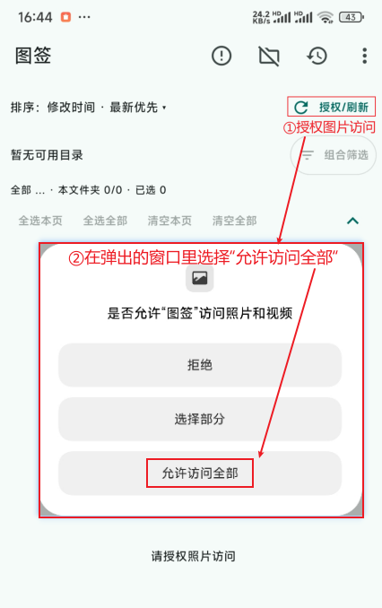
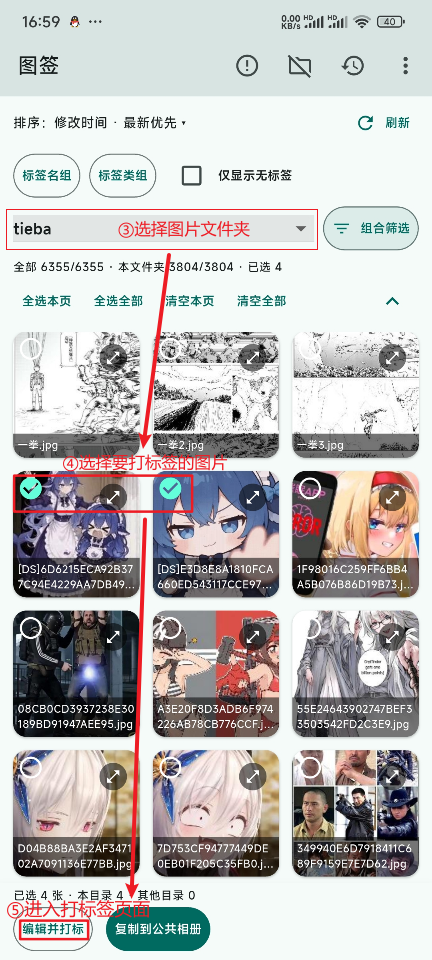
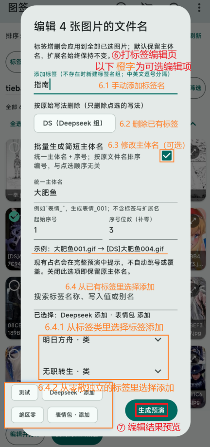
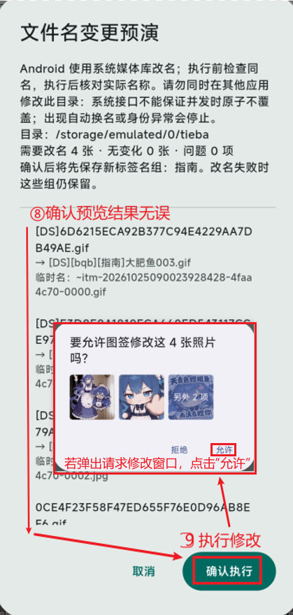
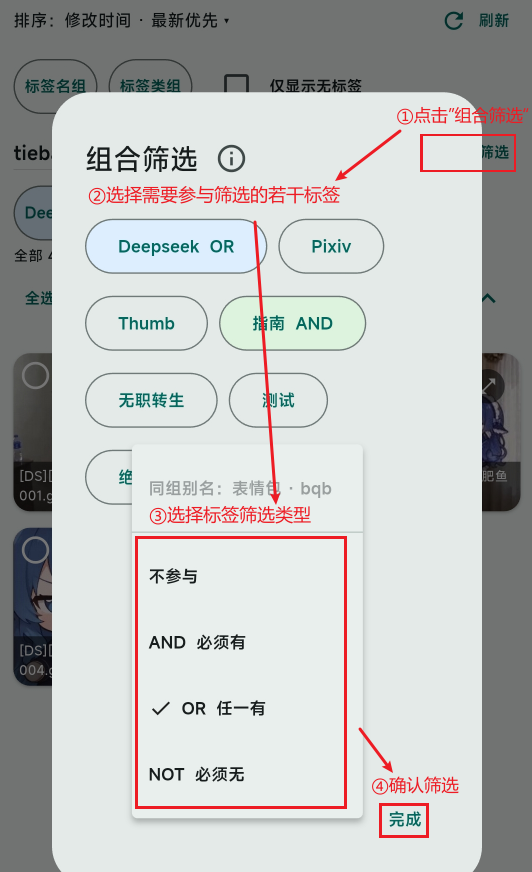
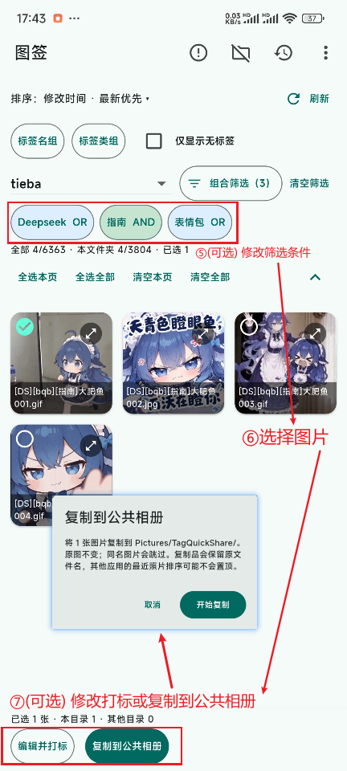
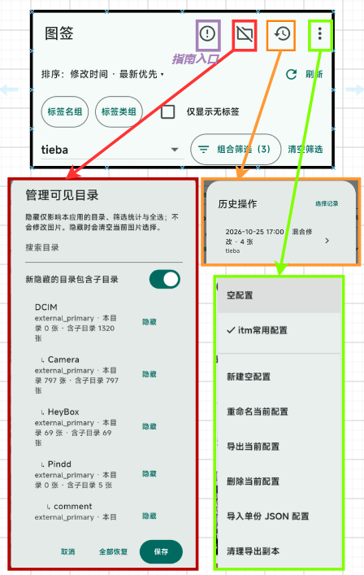
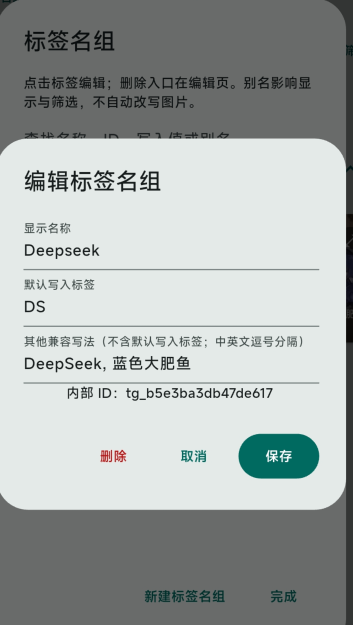
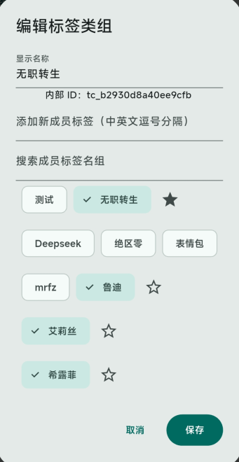

# 图签 Android 版使用指南

## 1. 原理与注意事项

图签把标签直接写进图片文件名，再根据这些标签筛选图片。打标签只修改文件名，不修改图片内容。

例如：
原文件名：`旅行照片.jpg`
添加标签：风景、收藏
新文件名：`[风景][收藏]旅行照片.jpg`

软件将文件名开头连续的 `[标签]` 识别为标签，其后的名称是主体名，末尾的 `.jpg`、`.png` 等是扩展名。
上例中，“风景”和“收藏”是标签，“旅行照片”是主体名，“.jpg”是扩展名。写在主体名中间的方括号不会作为前缀标签识别。

**怎么按标签找图？**

打开“组合筛选”，为参与筛选的标签选择条件：

- AND 必须有：例如同时包含“风景”和“收藏”。
- OR 任一有：例如包含“猫”或“狗”，至少有一个。
- NOT 必须无：例如排除“待整理”。

多个 AND 条件必须全部满足，多个 OR 条件至少满足一个，所有 NOT 条件都必须排除；不同类型的条件同时生效。

“`不参与`”表示不按这个标签筛选。
“`仅显示无标签`”用于查找没有文件名前缀标签的图片。

**注：改名会改变图片的文件路径。依赖原文件名或路径的软件，可能出现引用失效、找不到图片或需要重新导入的情况。**

## 2. 打标流程

注：原图改名每批须来自同一目录。

## 3. 找图流程

## 4. 其他功能

点击图片可放大查看。

### 标签名组

将同义标签写法归为一组，可设置显示名称、默认写入标签和别名。

### 标签类组

用于收纳标签名组，方便分类查找和选择。实心 ★ 表示该类组的默认标签。

### 管理可见目录
可以自定义图片文件夹不显示在选择列表中。

### 历史操作与恢复

已完成的改名操作可以从“历史操作”进入撤销；撤销也会检查当前文件状态，不保证外部修改后仍能撤销。

### 配置

可以保存多套标签设置，支持新建、切换、重命名、删除，以及导出当前配置、导入单份配置。

### 复制到公共相册与清理副本

“复制到公共相册”会生成副本，方便在其他软件选择筛选出的图片。
副本位于 `Pictures/TagQuickShare/`，需要清理时，可从右上角菜单点击`清理导出副本`，核对后删除。
